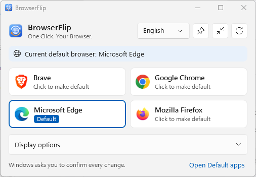
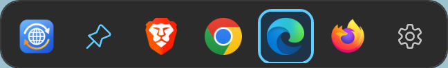

# BrowserFlip

[English](README.md) | **日本語** | [简体中文](README.zh-CN.md)

[](https://github.com/tlzs-oss/browserflip/actions/workflows/ci.yml)
[](LICENSE)

> **One Click. Your Browser.**

BrowserFlip は、PC にインストールされている Web ブラウザーを一覧表示し、現在の既定ブラウザーを示し、ワンクリックで Windows の設定の該当ページへ直接移動できる、小さなオープンソースの Windows 10/11 デスクトップアプリです。





> **ステータス:** プレリリース(0.1.0 MVP と 0.2.0 デスクトップ機能を開発中)。リリースはまだ公開されていません。

## 機能

- **ブラウザーの自動検出** — Windows 標準の登録情報(`Software\Clients\StartMenuInternet` と `Software\RegisteredApplications`、ユーザー単位/マシン単位、64 ビット/32 ビット ビュー)を読み取ります。実行ファイルのパスはハードコードしていません。
- **見やすいカード一覧** — 2 列のカードにブラウザーのアイコン・名前・「現在の既定」バッジを表示。カード全体がクリック可能です。
- **ワンクリックで設定へ** — Windows 11(2023 年 4 月の更新プログラム以降)ではそのブラウザー専用の「既定のアプリ」ページを、それ以外では「既定のアプリ」トップページを開きます。
- **状態のライブ更新** — 設定から戻ると `http` / `https` の既定を再取得し、新しい既定を表示します。
- **不一致の警告** — `http` と `https` の既定が異なるアプリの場合に警告します。
- **分かりやすいメッセージ** — アンインストール済みブラウザー（カードを無効表示）、登録が不完全なブラウザー（「既定のアプリ」のトップを開き案内を表示）、グループ ポリシーによる制限、変更のキャンセルをそれぞれ説明します。
- **ダークモード**(Windows のアプリ テーマに追従)、**Per-Monitor V2 高 DPI**、**キーボード操作 / スクリーン リーダー対応**。
- **English・日本語・简体中文** — Windows の言語から自動選択し、実行中に切り替え可能です。

0.2 の新機能(未リリース):

- **専用アイコン** — 地球と矢印のオリジナル図案(MIT)。EXE・ウィンドウ・タスクバー・通知領域で使用します。
- **常に手前に表示** — 通常画面とバーのピン ボタンで切り替えます。OFF は斜めの灰色のピン、ON は青い背景に白い直立したピンです。他のウィンドウより手前に出すかどうかはこの設定だけで決まります(ドッキングとは無関係)。全画面アプリやプレゼンテーションの実行中は一時的に解除します。
- **コンパクトバー** — ブラウザーを並べた小さな横 / 縦のツールバー。既定のブラウザーを強調表示します。通常画面のコンパクトバー ボタンで、通常画面の中央にフローティングで表示します。アプリ アイコンのボタンで、元の位置の通常画面に戻ります。
- **画面端へのドッキング** — バーを左・右・上・下のいずれかの端へドラッグするとドッキングします。ドラッグ中は半透明の枠でドッキング先を表示し、上下の端では横、左右の端では縦に自動で切り替わります。端から離すとフローティングになります。通常画面のタイトル バーをドラッグし、カーソルを画面端に押し当てたまま離すと、そのモニターのその端にドッキングしたバー(収納済み)に切り替わります(普通の移動では切り替わりません)。作業領域は変更しません。
- **自動的に隠す** — ドッキング中のバーはフェードして隠れ、画面端に細い帯だけを残します。バーのある画面端にマウスを近づける(または帯をクリック、通知領域アイコンを使う)とフェードして戻ります。
- **通知領域アイコンと閉じる動作** — アイコンは常に表示します。通常画面の × は BrowserFlip を通知領域に隠し(終了せず、表示モードや位置も変えません)、最小化ボタン(—)は通常どおりタスクバーへ最小化します。バーの ×(または Alt+F4)は、フローティングのバーなら通知領域に隠し、ドッキング中のバーなら端に収納します。アイコンの左クリック(または BrowserFlip の再起動)で、使っていた画面を元の位置に戻します。右クリック メニューは「BrowserFlip を表示 / コンパクトバーを表示 / 設定… / 常に手前に表示 / BrowserFlip を終了」です。終了は「BrowserFlip を終了」です。
- **複数モニター / モニターごとの DPI** — モニター・解像度・拡大率・タスクバーの変更やスリープ復帰の後に再配置し、画面外に消えません。

## 仕組み

なぜワンクリックで既定を静かに切り替えず、Windows の設定を開くのでしょうか。

それは **Windows が既定ブラウザーの選択を保護している** からです。Windows 8 以降、この選択は保護用ハッシュと共に保存され、Windows は変更を設定画面でユーザー自身が確認することを意図的に求めています。レジストリを直接書き換えたりハッシュを偽造したりするツールは Windows のセキュリティ機能に逆らうものであり、Windows Update で動かなくなったり、マルウェアとして検出されたりすることがよくあります。

BrowserFlip はサポートされた方法だけを使います。

1. レジストリからブラウザーを **検出**(読み取り専用)。
2. ドキュメント化された `AssocQueryStringW` API で現在の `http` / `https` ハンドラーを **取得**。
3. Windows が対応している場合(Windows 11 21H2 ビルド 22000.1817 以上、22H2 ビルド 22621.1555 以上、または 23H2 以降)は `ms-settings:defaultapps?registeredAppUser=<名前>` / `registeredAppMachine=<名前>` を、それ以外では `ms-settings:defaultapps` を **開く**。
4. 設定画面で **ユーザーが**「既定値に設定」をクリック — Windows の確認は決して省略しません。
5. 戻ってきたら変更を **確認** し、カードを更新。

図は [docs/architecture.md](docs/architecture.md) を参照してください。

## 動作要件

- Windows 10 バージョン 1809(ビルド 17763)以降、または Windows 11
  - ブラウザー別の設定ページは、2023 年 4 月の累積更新プログラム適用済みの Windows 11(21H2 は 22000.1817 以上、22H2 は 22621.1555 以上)または 23H2 以降で開きます。Windows 10 とそれより古い Windows 11 では「既定のアプリ」全体のページが開きます。
- x64 または Arm64
- 管理者権限は不要
- ソースからのビルドには [.NET 10 SDK](https://dotnet.microsoft.com/download) が必要

## インストール

最初のリリースで、`win-x64` / `win-arm64` 向けの自己完結型シングルファイル `.zip` と `SHA256SUMS` を [Releases](https://github.com/tlzs-oss/browserflip/releases) ページで配布する **予定** です。

PowerShell でのハッシュ確認:

```powershell
Get-FileHash .\BrowserFlip-win-x64.zip -Algorithm SHA256
# SHA256SUMS の該当行と比較してください
```

> リリース バイナリはまだコード署名されていないため、Windows SmartScreen の警告が表示される場合があります。

## ソースからのビルド

```powershell
git clone https://github.com/tlzs-oss/browserflip.git
cd browserflip
dotnet build BrowserFlip.slnx -c Release
dotnet test BrowserFlip.slnx
dotnet run --project src/BrowserFlip.App
```

## 使い方

1. BrowserFlip を起動します。インストール済みのブラウザーがカードで表示され、現在の既定にはバッジが付きます。
2. 使いたいブラウザーをクリック(または Enter / Space)します。
3. Windows の設定が開きます。「既定値に設定」(Windows 11)をクリックするか、「Web ブラウザー」でブラウザーを選択(Windows 10)します。
4. BrowserFlip に戻ると、バッジが新しい既定に移動します。変更がなかった場合はその旨を表示します。

コンパクトバー・ドッキング・自動的に隠す・通知領域アイコンの使い方は [操作説明 (docs/user-guide.ja.md)](docs/user-guide.ja.md) を参照してください。

## よくある質問

**設定を開かずに既定を変更できないのはなぜですか?**
Windows は既定アプリの変更をユーザー自身が確認することを意図的に要求しています。BrowserFlip がそれを回避することはありません。[仕組み](#仕組み) を参照してください。

**ブラウザーが一覧に表示されません。**
BrowserFlip は `StartMenuInternet` に登録され、`http`/`https` の URL 関連付けを宣言しているブラウザーのみを表示します。登録を行わないポータブル版は表示されません。ブラウザーのインストーラーを再実行するか、ブラウザー自身の「既定にする」機能を使うと登録されることが多いです。アプリ ユーザー モデル ID(`registeredAUMID`)で登録されるパッケージ版(MSIX / Microsoft Store)のブラウザーは現時点では検出されません(対応予定)。

**カードがグレー表示になっています。**
登録は残っていますが、実行ファイルが見つかりません。アンインストールされた可能性があります。

**ブラウザー専用ではなく「既定のアプリ」全体のページが開きました。**
Windows 10 や 2023 年 4 月の更新プログラム未適用の Windows 11 の場合、またはブラウザーが `RegisteredApplications` に登録されていない場合です。表示されたページでブラウザーを手動で選択してください。

**http と https で別のアプリが使われていると表示されます。**
設定でそのブラウザーのページを開き、両方の既定に設定してください(Windows 11 の「既定値に設定」ボタンで両方設定されます)。

**組織が管理している PC です。**
グループ ポリシーで設定アプリや「既定のアプリ」ページが非表示になっている場合、BrowserFlip はページを開かずにメッセージを表示します。既定の関連付けポリシーが構成されている場合、次回サインイン時に選択が元に戻ることがあります。

**管理者権限は必要ですか?**
いいえ。昇格を求めることはありません。

## プライバシー

- **テレメトリなし**。分析・クラッシュ レポートも送信しません。
- **ネットワーク アクセスなし**。インターネットに接続しません。
- レジストリの **読み取り** と `ms-settings:` URI の起動のみを行い、レジストリへの書き込みは一切行いません。
- 書き込むファイルは `%LOCALAPPDATA%\BrowserFlip\settings.json` のみです。言語と表示設定(テーマ、表示モード、最前面、ドッキング、ウィンドウとバーの位置)を保存します。削除すると初期状態に戻ります。

## ロードマップ

今後のフェーズで予定(未実装): パッケージ版(MSIX / Store)ブラウザーの検出、グローバル ホットキー、起動時チェック、ポータブル版、インストーラー、更新通知、自動化手段の調査(Windows がサポートする仕組みが存在する場合のみ)。

## コントリビュート

歓迎します。[CONTRIBUTING.md](CONTRIBUTING.md) と [行動規範](CODE_OF_CONDUCT.md) をお読みください。セキュリティの問題は [SECURITY.md](SECURITY.md) を参照してください。

その他のドキュメント: [操作説明](docs/user-guide.ja.md) · [アーキテクチャ](docs/architecture.md) · [v0.2 設計書](docs/desktop-design.ja.md) · [要件](docs/requirements.md) · [テスト](docs/testing.md) · [関連 OSS 調査](docs/oss-research.md) · [変更履歴](CHANGELOG.md)

## ライセンス

[MIT](LICENSE) © 2026 TLZS株式会社 and BrowserFlip contributors

BrowserFlip は Microsoft およびいずれのブラウザー ベンダーとも提携していません。製品名は各社の商標です。
