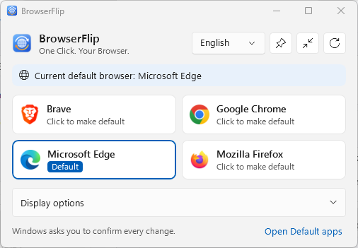

# BrowserFlip

**English** | [日本語](README.ja.md) | [简体中文](README.zh-CN.md)

[](https://github.com/tlzs-oss/browserflip/actions/workflows/ci.yml)
[](LICENSE)

> **One Click. Your Browser.**

BrowserFlip is a small, open-source Windows 10/11 desktop app that lists the web browsers installed on your PC, shows which one is currently the default, and takes you straight to the right place in Windows Settings to change it — in one click.




> **Status:** pre-release (0.1.0 MVP and 0.2.0 desktop features in development). Nothing has been published as a release yet.

## Features

- **Automatic browser detection** — reads the standard Windows registration (`Software\Clients\StartMenuInternet` and `Software\RegisteredApplications`, per-user and per-machine, 64-bit and 32-bit views). No hard-coded executable paths.
- **Clear card list** — two-column cards with the browser icon and name, plus a "current default" badge. The whole card is clickable.
- **One click to Settings** — opens the official Windows Settings *Default apps* page for that browser (Windows 11 with the April 2023 update or later), or the top-level *Default apps* page otherwise.
- **Live status** — re-reads the current `http` / `https` defaults after you return from Settings and highlights the new default.
- **Mismatch warning** — tells you when `http` and `https` are handled by different apps.
- **Helpful messages** — uninstalled browsers (card disabled), browsers that only registered partially (opens the general *Default apps* page with a hint), Group Policy restrictions, and cancelled changes are each explained.
- **Dark mode** (follows your Windows app theme), **Per-Monitor V2 high DPI**, and **keyboard navigation / screen reader names**.
- **English, 日本語, 简体中文** — picked automatically from Windows, switchable at runtime.

New in 0.2 (unreleased):

- **App icon** — an original globe-and-arrows design (MIT), used for the EXE, windows, taskbar and notification area.
- **Always on top** — a pin toggle in the main window and on the bar: a grey tilted pin when off, a white upright pin on blue when on. It alone decides whether BrowserFlip stays above other windows (docking does not); temporarily released while a full-screen app or presentation is running.
- **Compact bar** — a small horizontal or vertical toolbar with your browsers; the default one is highlighted. The compact button in the main window opens it floating over the center of the window; the app-icon button takes you back to the main window where it was.
- **Edge docking** — drag the bar to any edge (left, right, top or bottom) to dock it; a translucent outline previews where it will land. Top/bottom edges make it horizontal, left/right edges vertical, automatically. Drag it away from the edges to let it float. You can also drag the main window by its title bar and release it with the cursor pushed against a screen edge: BrowserFlip turns into the bar docked (and already hidden) at that edge of that monitor; an ordinary move never switches. It never changes your work area.
- **Auto-hide** — a docked bar fades away and leaves a thin strip along the edge; move the mouse to the edge where the bar is (or click the strip, or use the tray icon) and it fades back in.
- **Notification area icon and closing** — the icon is always present. The main window's X hides BrowserFlip to the notification area (it keeps running; nothing else changes), and the minimize button (—) minimizes to the taskbar as usual. The compact bar has no close button (BF-06); Alt+F4 on the bar hides a floating bar to the notification area and retracts a docked bar into its edge. Left-click the icon (or start BrowserFlip again) to bring back whatever you were using, where it was; right click opens a menu (Show BrowserFlip / Show compact bar / Settings… / Always on top / Exit BrowserFlip). Exit with **Exit BrowserFlip**.
- **Multi-monitor and per-monitor DPI** — the bar and window are re-placed after monitor, resolution, scaling, taskbar or sleep/resume changes and never get lost off-screen.

## How it works

Why does one click open Windows Settings instead of switching the default silently?

Because **Windows protects your default browser choice**. Since Windows 8 the choice is stored together with a protection hash, and Windows deliberately requires that the user confirm the change in Settings. Tools that write the registry directly or forge that hash are working against a Windows security feature, may break with any Windows update, and are frequently flagged as malware.

BrowserFlip takes the supported route:

1. **Detect** browsers from the registry (read-only).
2. **Read** the effective `http` / `https` handlers with the documented `AssocQueryStringW` API.
3. **Open** `ms-settings:defaultapps?registeredAppUser=<name>` / `registeredAppMachine=<name>` where Windows supports it (Windows 11 21H2 build 22000.1817+, 22H2 build 22621.1555+, or 23H2 and later), or `ms-settings:defaultapps` as a fallback.
4. **You** click **Set default** in Settings — Windows' confirmation is never skipped.
5. **Watch** for the change when you come back and update the cards.

See [docs/architecture.md](docs/architecture.md) for diagrams.

## Requirements

- Windows 10 version 1809 (build 17763) or later, or Windows 11
  - The per-browser Settings page needs Windows 11 with the April 2023 cumulative update (21H2 22000.1817+, 22H2 22621.1555+) or 23H2 and later. Windows 10 and older Windows 11 builds open the general *Default apps* page.
- x64 or Arm64
- No administrator rights required
- To build from source: [.NET 10 SDK](https://dotnet.microsoft.com/download)

## Install

Pre-built downloads are **planned** for the first release: self-contained single-file `.zip` archives for `win-x64` and `win-arm64`, with a `SHA256SUMS` file, on the [Releases](https://github.com/tlzs-oss/browserflip/releases) page.

Verify a download in PowerShell:

```powershell
Get-FileHash .\BrowserFlip-win-x64.zip -Algorithm SHA256
# compare with the matching line in SHA256SUMS
```

> Release binaries are not code-signed yet, so Windows SmartScreen may show a warning.

## Build from source

```powershell
git clone https://github.com/tlzs-oss/browserflip.git
cd browserflip
dotnet build BrowserFlip.slnx -c Release
dotnet test BrowserFlip.slnx
dotnet run --project src/BrowserFlip.App
```

## Usage

1. Start BrowserFlip. Your installed browsers appear as cards; the current default has a badge.
2. Click (or press Enter / Space on) the browser you want.
3. Windows Settings opens. Click **Set default** (Windows 11) or pick the browser under *Web browser* (Windows 10).
4. Switch back to BrowserFlip. The badge moves to the new default. If nothing changed, BrowserFlip tells you so.

For the compact bar, docking, auto-hide and the notification area icon, see the user guide (Japanese): [docs/user-guide.ja.md](docs/user-guide.ja.md).

## FAQ

**Why can't BrowserFlip change the default without opening Settings?**
Windows intentionally requires the user to confirm default-app changes. BrowserFlip will never bypass that. See [How it works](#how-it-works).

**My browser is missing from the list.**
BrowserFlip only lists browsers that register themselves with Windows under `StartMenuInternet` and declare `http`/`https` URL associations. Portable builds that do not register are not shown. Re-running the browser's installer or its own "make default" option usually creates the registration. Packaged (MSIX / Microsoft Store) browsers that register through an app user model ID (`registeredAUMID`) are not detected yet — support is planned.

**A card is greyed out.**
The registration still exists, but the browser's executable is missing — it was probably uninstalled.

**Settings opened the general Default apps page instead of my browser's page.**
That happens on Windows 10 or Windows 11 builds without the April 2023 update, or when the browser is not listed in `RegisteredApplications`. Pick the browser there manually.

**It says http and https use different apps.**
Open the browser's page in Settings and set it as the default for both (Windows 11's **Set default** button does this).

**My organization manages this PC.**
If Group Policy hides Settings or the *Default apps* page, BrowserFlip shows a message instead of opening it. If a default associations policy is configured, your choice may be reverted at the next sign-in.

**Does it need admin rights?**
No. It never asks for elevation.

## Privacy

- **No telemetry**, no analytics, no crash reporting.
- **No network access.** BrowserFlip does not connect to the internet.
- It only **reads** the registry and launches `ms-settings:` URIs. It never writes registry values.
- The only file it writes is `%LOCALAPPDATA%\BrowserFlip\settings.json`, which stores your language and display preferences (theme, mode, always on top, docking, window and bar positions). Delete it to reset.

## Roadmap

Planned for later phases (not implemented): detection of packaged (MSIX / Store) browsers, global hotkey, startup check, portable build, installer, update notification, and research into automation — only if Windows offers a supported mechanism.

## Contributing

Contributions are welcome! Please read [CONTRIBUTING.md](CONTRIBUTING.md) and our [Code of Conduct](CODE_OF_CONDUCT.md). Security issues: see [SECURITY.md](SECURITY.md).

Further docs (Japanese): [User guide](docs/user-guide.ja.md) · [Architecture](docs/architecture.md) · [Desktop design (0.2)](docs/desktop-design.ja.md) · [Requirements](docs/requirements.md) · [Testing](docs/testing.md) · [Related OSS research](docs/oss-research.md) · [Changelog](CHANGELOG.md)

## License

[MIT](LICENSE) © 2026 TLZS株式会社 and BrowserFlip contributors

BrowserFlip is not affiliated with Microsoft or any browser vendor. Product names are trademarks of their respective owners.
