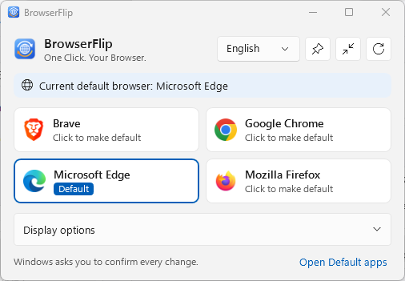

# BrowserFlip

[English](README.md) | [日本語](README.ja.md) | **简体中文**

[](https://github.com/tlzs-oss/browserflip/actions/workflows/ci.yml)
[](LICENSE)

> **One Click. Your Browser.**

BrowserFlip 是一款小巧的开源 Windows 11 桌面应用:列出电脑上已安装的浏览器,显示当前的默认浏览器,并一键直达 Windows 设置中对应的页面来更改它。




> **状态:** v0.2.0 是首个公开发布版本。仅在 Windows 11(x64)上验证过(参见[系统要求](#系统要求))。

## 功能

- **自动检测浏览器** — 读取 Windows 标准注册信息(`Software\Clients\StartMenuInternet` 和 `Software\RegisteredApplications`,包括当前用户/本机、64 位/32 位视图)。不硬编码任何可执行文件路径。
- **清晰的卡片列表** — 双列卡片显示浏览器图标、名称和"当前默认"标记,整张卡片均可点击。
- **一键打开设置** — 在 Windows 11(已安装 2023 年 4 月更新或更高版本)上打开该浏览器专属的"默认应用"页面,其他情况打开"默认应用"首页。
- **实时状态** — 从设置返回后重新读取 `http` / `https` 默认值并标出新的默认浏览器。
- **不一致警告** — 当 `http` 与 `https` 由不同应用处理时给出提示。
- **友好的提示** — 对已卸载的浏览器（卡片显示为不可用）、注册不完整的浏览器（打开“默认应用”首页并给出提示）、组策略限制以及取消更改等情况分别说明。
- **深色模式**(跟随 Windows 应用主题)、**Per-Monitor V2 高 DPI**、**键盘导航 / 屏幕阅读器名称**。
- **English、日本語、简体中文** — 根据 Windows 语言自动选择,可在运行时切换。

0.2 新功能:

- **适应语言的主窗口** — 默认宽度按当前语言实测,标题栏不会重叠:窗口较窄时先让标语换行,再窄时按钮移到第二行(按钮不会被隐藏)。拖动边框调整的宽度会被记住。
- **专属图标** — 地球加箭头的原创设计(MIT),用于 EXE、窗口、任务栏和通知区域。
- **置顶显示** — 通过主窗口和工具栏上的图钉按钮切换:关闭时为倾斜的灰色图钉,开启时为蓝色背景上竖直的白色图钉。是否显示在其他窗口之上只由此设置决定(与停靠无关);全屏应用或演示运行期间会暂时取消置顶。
- **紧凑工具栏** — 列出浏览器的小型横向 / 纵向工具栏,突出显示默认浏览器。点击主窗口中的紧凑工具栏按钮,工具栏会以浮动状态显示在主窗口中央;点击应用图标按钮即可回到原位置的主窗口。
- **停靠到屏幕边缘** — 将工具栏拖到左、右、上、下任一边缘即可停靠;拖动时以半透明轮廓预览停靠位置。停靠在上下边缘时自动为横向,停靠在左右边缘时自动为纵向。拖离边缘即变为浮动。也可以按住主窗口的标题栏拖动,并在光标抵住屏幕边缘时松开:BrowserFlip 会切换为停靠在该显示器该边缘(已收起)的工具栏;普通的移动不会切换。不会改变工作区。
- **自动隐藏** — 停靠的工具栏会淡出隐藏,只在屏幕边缘留下一条细条;将鼠标移到工具栏所在的屏幕边缘(或点击细条、使用通知区域图标)即可淡入恢复。
- **通知区域图标与关闭行为** — 图标始终显示。主窗口的 × 会把 BrowserFlip 隐藏到通知区域(不退出,也不改变显示模式和位置),最小化按钮(—)则照常最小化到任务栏。紧凑工具栏没有关闭按钮(BF-06);在工具栏上按 Alt+F4 会把浮动的工具栏隐藏到通知区域,把已停靠的工具栏收起到所在边缘。左键单击图标(或再次启动 BrowserFlip)即可在原位置恢复之前使用的界面;右键菜单为“显示 BrowserFlip / 显示紧凑工具栏 / 设置… / 置顶显示 / 退出 BrowserFlip”。请通过“退出 BrowserFlip”退出。
- **多显示器 / 每显示器 DPI** — 在显示器、分辨率、缩放比例、任务栏变化或睡眠唤醒后重新定位,不会消失在屏幕外。

## 工作原理

为什么一键之后是打开 Windows 设置,而不是直接静默切换?

因为 **Windows 会保护你的默认浏览器选择**。从 Windows 8 开始,该选择与一个保护哈希一同保存,Windows 有意要求用户在设置中亲自确认更改。直接改写注册表或伪造哈希的工具是在对抗 Windows 的安全机制,随时可能因 Windows 更新而失效,也经常被识别为恶意软件。

BrowserFlip 只使用受支持的方式:

1. 从注册表 **检测** 浏览器(只读)。
2. 通过有文档的 `AssocQueryStringW` API **读取** 当前的 `http` / `https` 处理程序。
3. 在 Windows 支持时(Windows 11 21H2 内部版本 22000.1817 及以上、22H2 内部版本 22621.1555 及以上,或 23H2 及更高版本)**打开** `ms-settings:defaultapps?registeredAppUser=<名称>` / `registeredAppMachine=<名称>`,否则打开 `ms-settings:defaultapps`。
4. 由 **你** 在设置中点击"设为默认值" — 绝不跳过 Windows 的确认。
5. 返回后 **检查** 更改并更新卡片。

示意图请参阅 [docs/architecture.md](docs/architecture.md)(日文)。

## 系统要求

- Windows 11(已在 x64 上验证)
  - 浏览器专属设置页需要已安装 2023 年 4 月累积更新的 Windows 11(21H2 为 22000.1817 及以上,22H2 为 22621.1555 及以上)或 23H2 及更高版本;较旧的 Windows 11 打开通用的"默认应用"页面。
  - **Windows 10 尚未验证,不在 v0.2.0 的支持范围内。**
- x64 或 Arm64(Arm64 版尚未在实机上测试)
- 无需管理员权限
- 从源码构建需要 [.NET 10 SDK](https://dotnet.microsoft.com/download)

## 安装

下载最新版本(**v0.2.0**)。自包含单文件应用(zip 内另附许可证与第三方声明文件),无需安装 .NET:

- [BrowserFlip-v0.2.0-win-x64.zip](https://github.com/tlzs-oss/browserflip/releases/download/v0.2.0/BrowserFlip-v0.2.0-win-x64.zip)(Windows 11,x64)
- [BrowserFlip-v0.2.0-win-arm64.zip](https://github.com/tlzs-oss/browserflip/releases/download/v0.2.0/BrowserFlip-v0.2.0-win-arm64.zip)(Windows 11,Arm64,仅完成构建,未在实机验证)
- [SHA256SUMS.txt](https://github.com/tlzs-oss/browserflip/releases/download/v0.2.0/SHA256SUMS.txt) · [所有版本](https://github.com/tlzs-oss/browserflip/releases/latest)

解压后运行 `BrowserFlip.exe`。在 PowerShell 中校验:

```powershell
Get-FileHash .\BrowserFlip-v0.2.0-win-x64.zip -Algorithm SHA256
# 与 SHA256SUMS.txt 中对应的行比较

# 可选:使用 GitHub CLI 验证构建来源(Sigstore)
gh attestation verify .\BrowserFlip-v0.2.0-win-x64.zip --repo tlzs-oss/browserflip
```

> EXE **未进行 Authenticode 代码签名**,Windows SmartScreen 可能会显示"Windows 已保护你的电脑"。如果你信任下载来源,请选择"更多信息"→"仍要运行"。Sigstore 证明用于说明文件的构建来源,并不是代码签名。

## 从源码构建

```powershell
git clone https://github.com/tlzs-oss/browserflip.git
cd browserflip
dotnet build BrowserFlip.slnx -c Release
dotnet test BrowserFlip.slnx
dotnet run --project src/BrowserFlip.App
```

## 使用方法

1. 启动 BrowserFlip。已安装的浏览器以卡片形式显示,当前默认浏览器带有标记。
2. 点击(或按 Enter / Space)想要使用的浏览器。
3. Windows 设置随即打开。点击"设为默认值"(Windows 11),或在"Web 浏览器"下选择该浏览器(Windows 10,v0.2.0 未验证、不在支持范围内)。
4. 切回 BrowserFlip,标记会移动到新的默认浏览器。如果没有更改,BrowserFlip 会给出提示。

紧凑工具栏、停靠、自动隐藏和通知区域图标的用法请参阅使用说明(日文):[docs/user-guide.ja.md](docs/user-guide.ja.md)。

## 常见问题

**为什么不能不打开设置就直接更改默认浏览器?**
Windows 有意要求用户亲自确认默认应用的更改,BrowserFlip 绝不会绕过这一点。参见 [工作原理](#工作原理)。

**我的浏览器没有出现在列表中。**
BrowserFlip 只列出在 `StartMenuInternet` 下注册并声明了 `http`/`https` URL 关联的浏览器。不进行注册的便携版不会显示。重新运行浏览器安装程序或使用浏览器自身的"设为默认"功能通常会创建注册信息。通过应用用户模型 ID(`registeredAUMID`)注册的打包版(MSIX / Microsoft Store)浏览器目前不会被检测到(计划支持)。

**某张卡片显示为灰色。**
注册信息仍然存在,但找不到浏览器的可执行文件,可能已被卸载。

**设置打开的是通用"默认应用"页面,而不是浏览器专属页面。**
这会发生在 Windows 10(v0.2.0 不在支持范围内)或未安装 2023 年 4 月更新的 Windows 11 上,或者浏览器未在 `RegisteredApplications` 中注册时。请在该页面中手动选择浏览器。

**提示 http 与 https 使用了不同的应用。**
在设置中打开该浏览器的页面,并将其设为两者的默认值(Windows 11 的"设为默认值"按钮会同时设置)。

**我的电脑由组织管理。**
如果组策略隐藏了设置或"默认应用"页面,BrowserFlip 会显示提示而不是打开页面。如果配置了默认关联策略,你的选择可能会在下次登录时被还原。

**需要管理员权限吗?**
不需要,它从不请求提升权限。

## 隐私

- **无遥测**,不做分析,不发送崩溃报告。
- **无网络访问**,BrowserFlip 不会连接互联网。
- 仅 **读取** 注册表并启动 `ms-settings:` URI,从不写入注册表。
- 唯一写入的文件是 `%LOCALAPPDATA%\BrowserFlip\settings.json`,用于保存语言和显示设置(主题、显示模式、置顶、停靠、窗口和工具栏位置)。删除该文件即可恢复默认设置。

## 路线图

后续阶段计划(尚未实现):检测打包版(MSIX / Store)浏览器、全局热键、启动时检查、便携版、安装程序、更新通知,以及自动化方式的调研(仅限 Windows 提供受支持机制的情况)。

## 参与贡献

欢迎贡献!请阅读 [CONTRIBUTING.md](CONTRIBUTING.md) 和 [行为准则](CODE_OF_CONDUCT.md)。安全问题请参阅 [SECURITY.md](SECURITY.md)。

更多文档(日文):[使用说明](docs/user-guide.ja.md) · [架构](docs/architecture.md) · [v0.2 设计](docs/desktop-design.ja.md) · [需求](docs/requirements.md) · [测试](docs/testing.md) · [相关开源项目调研](docs/oss-research.md) · [更新日志](CHANGELOG.md)

## 许可证

[MIT](LICENSE) © 2026 TLZS株式会社 and BrowserFlip contributors

BrowserFlip 与 Microsoft 及任何浏览器厂商均无关联。产品名称为其各自所有者的商标。
