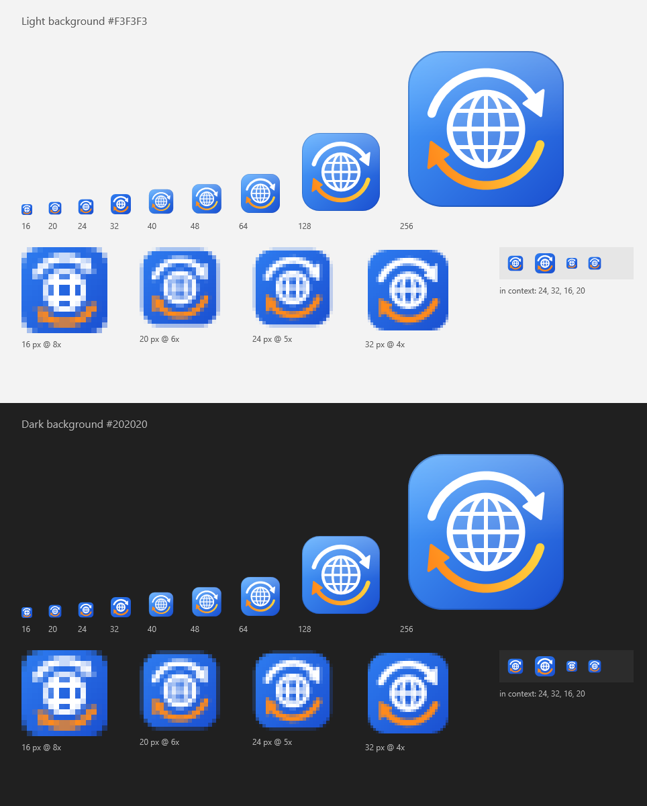

# BrowserFlip icon



## Design rationale

- **Globe** = the web / your browser. Drawn as a plain wireframe (outline, meridians, parallels) so it
  reads as "the internet" rather than as any particular browser.
- **Two circular arrows** around the globe = switching / flipping the default. The white arrow and
  the warm accent arrow chase each other, which says "swap A for B" in one glance.
- **Blue rounded-square tile** with a soft diagonal gradient, a light top gloss and a faint edge line
  gives the subtle depth of Windows 11 Fluent app icons. Corner radius is about 22 % of the tile.
- Deliberately avoided: tri-colour rings, waves, flames/animals, compass needles and letterforms,
  so the icon does not resemble any browser's logo. No text in the icon.

## Palette

| Role | Hex |
| --- | --- |
| Tile gradient, light (40 px and up) | `#4CA6FF` |
| Tile gradient, light (32 px and below, slightly darker for contrast) | `#2E7CF0` |
| Tile gradient, deep | `#1A4FD0` |
| Tile edge line (30 % opacity) | `#0B2F7A` |
| Globe and main arrow | `#FFFFFF` (globe body fill at 16 % opacity) |
| Accent arrow gradient | `#FFD23F` to `#FF8A1C` (solid `#FF8A1C` at 32 px and below) |

## Size variants

| File | Used for | Notes |
| --- | --- | --- |
| `browserflip.svg` | 40 px and up (master) | Full globe grid, gradient accent, gloss and edge line |
| `browserflip-small.svg` | 20, 24, 32 px | Larger tile, one meridian + equator, much thicker strokes, solid accent |
| `browserflip-16.svg` | 16 px | Pixel-fitted: full-bleed tile, 1 px globe outline and "#" grid on pixel centres, 1.5 px arrows |

Outputs:

- `png/browserflip-{16,24,32,48,64,128,256,512}.png` (transparent background)
- `browserflip.ico` with 16, 20, 24, 32, 40, 48, 64 and 256 px entries
  (256 stored as PNG, smaller sizes as 32-bit BMP with alpha)
- `preview.png`: every size on light (`#F3F3F3`) and dark (`#202020`) backgrounds, plus pixel zooms

## Regenerating

All files in this folder (except this README) are generated. The artwork is defined once in
`scripts/icon/IconGen/Design.cs`; edit it there and run:

```powershell
powershell -ExecutionPolicy Bypass -File scripts/icon/generate.ps1
```

Requires Windows and the .NET 10 SDK. See `scripts/icon/README.md` for details.

## License

The BrowserFlip icon is part of this repository and licensed under MIT like the code.
