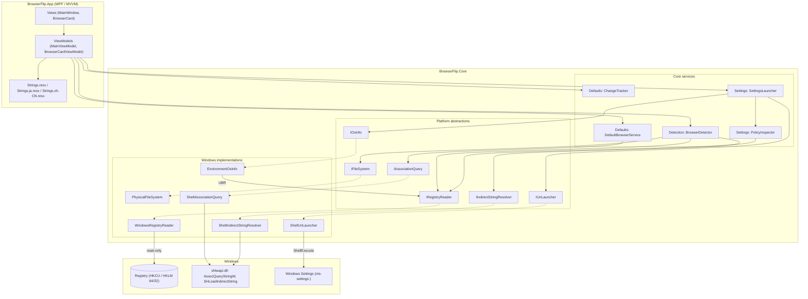
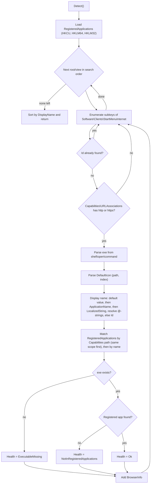
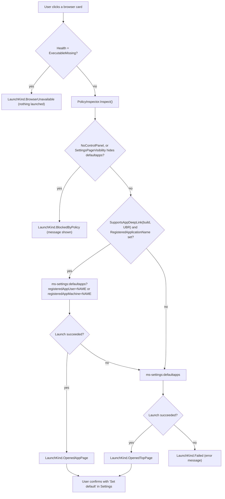
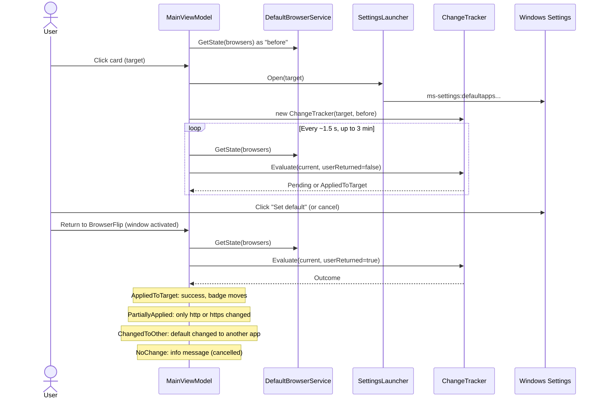
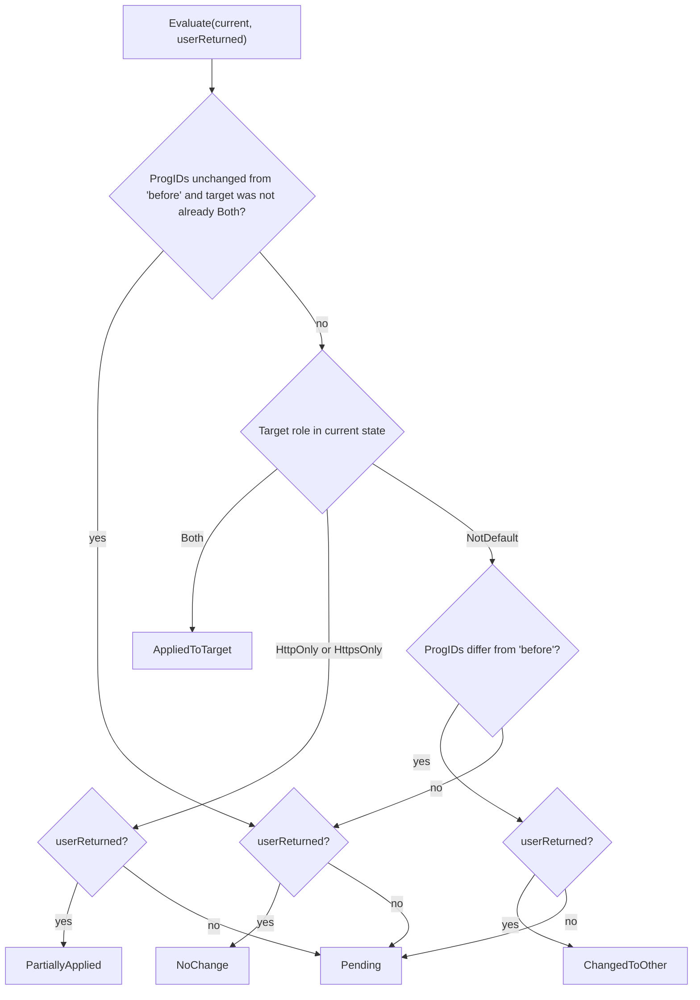

# アーキテクチャ

BrowserFlip の構成と主要な処理フローを説明します。対象バージョンは 0.1.0(MVP、開発中)です。

- 要件: [requirements.md](requirements.md) / テスト: [testing.md](testing.md) / 関連 OSS 調査: [oss-research.md](oss-research.md)
- 参考: [Launch the Default Apps settings page (Microsoft Learn)](https://learn.microsoft.com/en-us/windows/apps/develop/launch/launch-default-apps-settings)

## 1. 設計方針

| 方針 | 内容 |
| --- | --- |
| Windows の確認を尊重 | 既定ブラウザーは Windows の設定画面でユーザー自身が確定する。BrowserFlip は設定画面を開き、結果を観察するだけ。 |
| 読み取り専用 | レジストリは `writable: false` でのみ開く。`UserChoice` / `UserChoiceLatest` への書き込み、ハッシュ計算・偽造、DISM の既定関連付け XML は一切使わない。 |
| 管理者権限不要 | 昇格を要求しない(`asInvoker`)。 |
| 起動する URI の制限 | `ShellUriLauncher` は `ms-settings:` スキーム以外を例外で拒否する。 |
| 依存ゼロ | 本体プロジェクトはサードパーティ パッケージに依存しない(テスト用パッケージのみ `Directory.Packages.props` で集中管理)。 |
| テスト容易性 | OS への依存はすべて `Platform` 層のインターフェイス越しに扱い、単体テストではフェイクに差し替える。 |

## 2. レイヤー構成

| プロジェクト | ターゲット | 役割 |
| --- | --- | --- |
| `src/BrowserFlip.App` | `net10.0-windows` (WPF) | View / ViewModel(MVVM)、テーマ、DPI、多言語リソース |
| `src/BrowserFlip.Core` | `net10.0-windows` | 検出・既定状態・設定起動・ポリシー判定のロジック、および Windows 実装 |
| `tests/BrowserFlip.Core.Tests` | xUnit | Core の単体テスト(`InternalsVisibleTo` で internal も検証) |
| `tests/BrowserFlip.App.Tests` | xUnit (WPF) | ViewModel・多言語・設定ファイルの単体テスト(Core のフェイクを共有) |

### 主要な型(Core)

| 名前空間 | 型 | 概要 |
| --- | --- | --- |
| `Detection` | `BrowserDetector` | 登録済みブラウザーを列挙し `BrowserInfo` を返す |
| `Detection` | `BrowserInfo` / `BrowserHealth` / `RegistrationScope` | ブラウザー情報。`Health` は `Ok` / `ExecutableMissing` / `NotInRegisteredApplications` |
| `Detection` | `RegistryValueParser` | `shell\open\command`・`DefaultIcon` 文字列の解析、キー パスの正規化 |
| `Defaults` | `DefaultBrowserService` | `http` / `https` の現在のハンドラーを取得し、検出済みブラウザーに対応付ける |
| `Defaults` | `DefaultBrowserState` / `DefaultStatus` / `BrowserDefaultRole` | 状態スナップショット。`Status` は `None` / `Consistent` / `Mismatch` / `Unrecognized` |
| `Defaults` | `ChangeTracker` / `ChangeOutcome` | 設定画面での変更結果を判定する |
| `Settings` | `SettingsLauncher` / `LaunchResult` / `LaunchKind` | 設定画面を開く。ディープリンク → トップページの順にフォールバック |
| `Settings` | `PolicyInspector` / `PolicyStatus` | グループ ポリシーの読み取り |

## 3. ブラウザー検出フロー

検索順は HKCU(既定ビュー)→ HKLM 64 ビット → HKLM 32 ビット。同じキー名が複数にある場合は先に見つかったもの(ユーザー単位)が優先されます。

- `http` / `https` の URL 関連付けを宣言しないキー(例: Windows 11 の旧 `IEXPLORE.EXE` 登録)は除外します。
- 実行ファイル パスはレジストリから得るのみで、ハードコードはしません。
- MVP では `StartMenuInternet` に登録されないパッケージ版(MSIX / Microsoft Store)ブラウザー、およびそれを対象とする `registeredAUMID=` ディープリンクには対応していません(Phase 2 で予定)。

## 4. Windows 設定への遷移フロー

- `SupportsAppDeepLink(build, ubr)` は Microsoft Learn の記載に従い、Windows 11 21H2 + 2023-04 累積更新(10.0.22000.1817 以上)、22H2 + 2023-04 更新(10.0.22621.1555 以上)、23H2 以降で `true`。Windows 10 と、それより古い Windows 11 ビルドは `ms-settings:defaultapps` を開く。UBR は `EnvironmentOsInfo` が `HKLM\SOFTWARE\Microsoft\Windows NT\CurrentVersion` の `UBR`(DWORD)から読み取る(取得できなければ 0)。
- `registeredAppUser` / `registeredAppMachine` は `RegisteredApplications` が見つかったハイブ(`RegisteredApplicationScope`)で決まります。値は `Uri.EscapeDataString` でエスケープします。
- ディープリンクのパラメーターを解釈しないビルドでも設定は「既定のアプリ」トップページを開くため、安全に劣化します。
- `DefaultAssociationsConfiguration`(HKLM)が設定されている場合は遷移を止めず、「サインイン時に元に戻る可能性がある」旨の警告を App 層で表示します(`PolicyStatus.AssociationsManaged`)。

## 5. 状態確認と変更監視

既定の取得は `AssocQueryStringW(ASSOCF_IS_PROTOCOL, ASSOCSTR_PROGID)` で行います(`UserChoice` / `UserChoiceLatest` の格納形式に依存しない、ドキュメント化された読み取り方法)。取得タイミングは起動時、設定を開く前、待機中のポーリング(約 1.5 秒間隔、最大 3 分)、ウィンドウ再アクティブ化時です。ポーリング間隔とタイムアウトは App 層の責務で、`ChangeTracker` 自体は時間を持ちません。

`ChangeTracker.Evaluate` の判定:

- `http` と `https` は Windows 側で一瞬ずれて更新されることがあるため、片方のみの状態はユーザーが戻るまで `Pending` とします。
- `userReturned` は「ウィンドウが再アクティブ化された」または「待機がタイムアウトした」ときに `true` を渡します。
- 最初の分岐により、元から片方だけ既定だったブラウザーを選んで何も変更しなかった場合は `PartiallyApplied` ではなく `NoChange` になります。
- 再アクティブ化時に片方のみ反映済みだった場合、`MainViewModel` は約 3 秒の猶予を置いてから `PartiallyApplied` を報告します(もう片方の書き込み待ち)。

### 既定状態(`DefaultStatus`)の判定

| 条件 | Status |
| --- | --- |
| `http` / `https` ともに未設定 | `None` |
| 片方のみ設定 | `Mismatch` |
| 両方が同じ検出済みブラウザー | `Consistent` |
| 両方が別の検出済みブラウザー、または片方のみ検出済み | `Mismatch` |
| 両方未検出で ProgID が同じ | `Unrecognized` |
| 両方未検出で ProgID が異なる | `Mismatch` |

ProgID とブラウザーの対応付けは、(1) 同じプロトコルの ProgID 一致、(2) いずれかのプロトコルで宣言された ProgID 一致、(3) 実行ファイル パス一致(更新で ProgID が変わった場合)の順で行います。

## 6. App 層の設計

- MVVM。ViewModel は Core のサービスのみを使い、Win32 を直接呼ばない(アイコン抽出 `IconLoader` とタイトルバー配色 `ThemeManager` のみ App 層の Services で P/Invoke を使用)。
- テーマ: Windows のアプリ テーマ(ライト/ダーク)に追従。ハイ コントラスト時はシステム カラーを使用。
- 高 DPI: アプリケーション マニフェストで Per-Monitor V2 を宣言。
- 多言語: `Strings.resx`(英語、ニュートラル)/ `Strings.ja.resx` / `Strings.zh-CN.resx`。ユーザーの Windows 表示言語から自動選択し、実行中に切り替え可能。言語に応じて `xml:lang` とフォント(ja: Yu Gothic UI / zh-CN: Microsoft YaHei UI)を切り替え。
- アクセシビリティ: カードはキーボードで操作可能(Tab / Enter / Space)、`AutomationProperties.Name` を設定。
