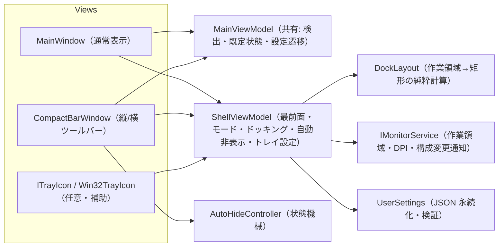
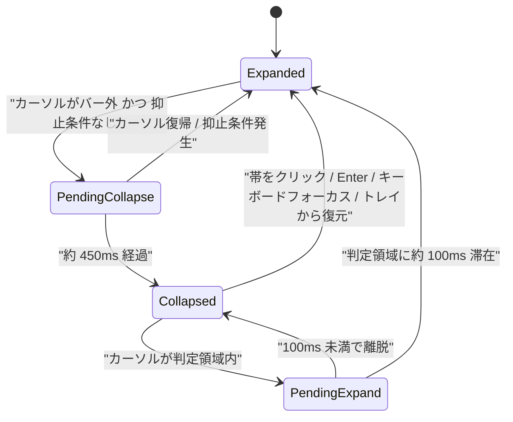

# バックログ / 次期バージョン設計（v0.2 デスクトップ操作性の強化）

> 対象: BrowserFlip v0.2（MVP v0.1 の後続）。目的は日常利用時の操作性と完成度の向上であり、機能範囲の無制限な拡大は行わない。
> 既存のブラウザー検出・Windows 設定遷移・既定ブラウザー判定（v0.1）は変更せず維持する。
> 状態: **V2-01〜V2-08 は実装済み（v0.2、未リリース）**。変更点は [CHANGELOG.md](../CHANGELOG.md)、実装の設計は [desktop-design.ja.md](desktop-design.ja.md)、操作方法は [user-guide.ja.md](user-guide.ja.md) を参照。
> 本書は実装前に作成した計画であり、実装で確定した値（寸法・時間など）に合わせて更新している。

## 1. 要件一覧

| ID | 要件 | 概要 | 状態 |
|---|---|---|---|
| V2-01 | 専用アプリアイコン | 地球（ブラウザー）＋切替矢印のオリジナル図案。SVG マスター、PNG 16/24/32/48/64/128/256/512、多解像度 ICO。EXE・ウィンドウ・タスクバー・通知領域に適用（インストーラーは将来）。既存ブラウザーのロゴと混同しない | 実装済み（v0.2、未リリース） |
| V2-02 | 最前面表示 | ピンボタンで `Topmost` を ON/OFF。通常・コンパクト両モード対応、設定を保存。全画面アプリ実行中は最前面を一時解除しシステム UI を妨げない。ピンは通常画面とバーで共通の ToggleButton（OFF = 傾いた灰色のピン、ON = 青い背景に白い直立したピン、状態に応じたツールチップ、固定のアクセシブル名と UI オートメーションのトグル状態、キーボード操作可）。最前面はこの設定だけで決まり、ドッキング・自動非表示とは独立（BF-02） | 実装済み（v0.2、未リリース） |
| V2-03 | コンパクトモード | ワンクリックで小型ツールバーへ切替（通常画面の中央にフローティングで表示し、通常画面に戻ると元の位置。BF-03）。横型（高さ 44 / 52 DIP）／縦型（幅 48 / 56 DIP）（サイズ「小 / 中」）。既定ブラウザーを強調、ホバーで名前の Tooltip、設定ボタン・通常画面復帰ボタン。多数のブラウザーはスクロール | 実装済み（v0.2、未リリース） |
| V2-04 | 画面端ドッキング | 左・右・上・下。既定はメイン モニターの右端。ドッキングはドラッグのみで決定：ドラッグ終了時にカーソルに最も近い作業領域の端（24 DIP 以内、端を越えた場合も含む）、なければウィンドウ端（はみ出しは接触扱い）でスナップ。端から離せばフローティング。上下＝横、左右＝縦に自動切替。ドラッグ中は半透明の枠でプレビュー。端・モニター・位置を保存して復元。通常画面をタイトルバーでドラッグし、カーソルを画面端に押し当てて（2 px 以内またはタスクバー上）離すと、そのモニターのその端に収納済みのバーでドッキング（BF-01。普通の移動・サイズ変更では切り替えない）。最前面は V2-02 の設定に従う（BF-02）。モニターごとの作業領域・DPI・タスクバー位置を考慮 | 実装済み（v0.2、未リリース） |
| V2-05 | 自動表示・非表示 | ドッキング中は常に有効（オプションなし）、フローティング中は隠さない。カーソルがバーから離れて 450ms 後にフェードアウト（160ms）して収納し、バーと同じ長さで厚さ 3〜5 px の帯を残す（表示・ドラッグ・トレイ復元直後は 1.5 秒保持）。バーの全長（両端 +8 DIP）× 奥行き 12〜20 px の判定領域に 100ms 滞在、または帯のクリック / Enter でフェードイン（160ms）して展開。ディスプレイ変更後は再表示 | 実装済み（v0.2、未リリース） |
| V2-06 | システムトレイ | 常に表示（オプションなし）。左クリックで使用中の画面を元の場所に復元、右クリックメニュー（BrowserFlip を表示・コンパクトバーを表示・設定・常に手前に表示・BrowserFlip を終了）。メイン ウィンドウの×はすべてのウィンドウを隠して通知領域のみ、—は通常の最小化、バーに閉じるボタンはなく（BF-06）、バーでの Alt+F4 はフローティングなら通知領域のみ、ドッキング中なら端に収納（BF-04。T13 の「×＝最小化」を置き換え）。終了はメニューまたはサインアウト / シャットダウンのみ。設定ファイルごとの単一インスタンス | 実装済み（v0.2、未リリース） |
| V2-07 | 設定の永続化 | 表示モード、最前面、ドッキング有効/位置、対象モニター、言語、テーマ、ウィンドウサイズ・位置。v0.1 の設定ファイルと互換 | 実装済み（v0.2、未リリース） |
| V2-08 | 複数モニター・DPI | Per-Monitor V2。接続/切断、解像度・拡大率変更、スリープ復帰、Explorer 再起動、タスクバー位置変更後に再配置。画面外へ消えない | 実装済み（v0.2、未リリース） |

## 2. 設計方針

- **既存ロジックの再利用**: Core と `MainViewModel` を共有し、コンパクトバーは同じ ViewModel の別ビューとする。
- **独立した状態管理**: ドッキング／自動非表示は `AutoHideController`（純粋な状態機械、時刻と入力を外部から与える）として実装し、ウィンドウ操作と分離する。配置計算は `DockLayout`（純粋関数）とする。いずれも単体テスト可能。
- **イベントループ防止**: ウィンドウ移動はコード側の移動とユーザーのドラッグを区別するガードを持ち、`LocationChanged` からの再配置が再帰しないようにする。
- **常駐負荷の最小化**: グローバルフックは使わない。カーソル位置の確認はドッキング＋自動非表示が有効な間のみ約 100ms 間隔で行い、無効時はタイマーを停止する。常駐サービス、通知、広告は追加しない。
- **AppBar 登録はしない**: `SHAppBarMessage` による作業領域の予約は行わず、作業領域内へのオーバーレイ表示とする（タスクバーや他ウィンドウのレイアウトに干渉しない）。
- **アニメーション**: Windows の「アニメーション効果」設定（`SystemParameters.ClientAreaAnimation`）が OFF の場合は即時に表示／収納する。
- **安全性は v0.1 と同一**: レジストリ書き込みなし、管理者権限不要、ネットワーク通信なし。

## 3. 構成

> 以下は実装前の計画図。実装では `DesktopCoordinator` がウィンドウ・`AutoHideController`・`DockLayout`・各サービスを統括する構成になった。実装後の構成図は [desktop-design.ja.md](desktop-design.ja.md#2-構成) を参照。

### 自動表示・非表示の状態遷移

抑止条件（収納しない）: バー上でマウスボタン押下中、ドラッグ中、コンテキストメニュー表示中、バーにキーボードフォーカスがある間。

**Windows の設定画面での変更待ち中は抑止しない**（実装時に変更）。ブラウザーをクリックして設定画面が開いた後は、バーが設定画面の操作を妨げないよう通常どおり収納する。変更の検出（ポーリング）は収納中も継続する。

## 4. 受入条件

1. 置頂を有効にすると前面に表示され、再起動後も維持される。全画面アプリ実行中は前面に割り込まない。ピンの ON / OFF が通常画面とバーで一目で区別でき（ライト／ダーク）、キーボードとスクリーンリーダーで操作・確認できる。ドッキング中のバーも置頂の設定に従う。
2. コンパクトバーのブラウザーをクリックすると v0.1 と同じ設定画面遷移・状態更新が行われる（回帰なし）。
3. 左右ドッキングでは縦型、上下では横型となり、各モニターの作業領域（タスクバーを除く）内に収まる。ドラッグで端に近づける（端を越えて押し出す場合も含む）とスナップし、端から離すとフローティングになる。通常画面をカーソルが画面端に押し当てられた状態で離すと、そのモニターのその端に収納済みのバーでドッキングし、普通の移動では切り替わらない。
4. 自動非表示では収納時にバーと同じ長さで厚さ 3〜5 px の帯のみ表示され、バーのある画面端への接近（バーの全長のどこでも、約 100ms 滞在）またはクリックで展開、離脱後約 450ms で収納される。抑止条件中は収納されない。設定画面での変更待ち中は収納され、設定画面を妨げない。
5. モニターの接続・切断、解像度／拡大率変更、スリープ復帰、タスクバー位置変更後も画面内に再配置される。保存位置が画面外なら補正される。
6. トレイアイコンは常に表示され、左クリック（と 2 回目の起動）で使用中の画面を元の場所に復元、右クリックメニューから表示・コンパクトバー・設定・最前面・終了が可能。Explorer 再起動後もアイコンが再表示される。メイン ウィンドウの×では終了せず通知領域のみになり、表示モード・ドッキング状態・位置・向きは変わらない。コンパクトバーに閉じるボタンはない（バーでの Alt+F4 はフローティングなら通知領域のみ、ドッキング中なら端に収納）。2 回目の起動でアイコンが 2 つにならない。
7. 設定は `%LOCALAPPDATA%\BrowserFlip\settings.json` に保存され、v0.1 の設定ファイルを読み込める。不正な値は既定値に戻る。
8. 100% / 125% / 150% / 200% の拡大率、拡大率の異なる 2 モニター環境で表示が崩れない。
9. 終了時にトレイアイコンと関連リソースが解放される。

## 4.1 追加: 通常画面のコンパクト化（v0.2 UI 改善・実装済み、未リリース）

| ID | 要件 | 実装 |
|---|---|---|
| U-01 | 初期サイズ約 520 × 380 DIP | 幅 520 DIP、高さは内容に合わせる(4 ブラウザーで約 350 DIP)。作業領域を上限にスクロール。BF-07 で、幅は言語ごとにヘッダーを実測した値(520 DIP 以上)に変更 |
| U-02 | 余白の解消・コンテンツ中心 | 1 行ヘッダー、帯、2 列カード、折りたたみオプション、下部 1 行 |
| U-03 | 2 列カード | アイコン・名前・既定状態(バッジ / 1 行の案内)。長い案内はツールチップ |
| U-04 | ヘッダー整理 | アプリ アイコン・名称・言語・最前面・コンパクトバー・再読み込み |
| U-05 | 表示オプション | 折りたたみ式を維持。開いても内容が隠れない(ウィンドウが伸び、超過時はスクロール) |
| U-06 | 3 言語・DPI | en / ja / zh-CN、100 / 150 / 225 % で文字の重なり・切れなし(自動テスト＋実機スクリーンショット) |
| U-07 | テーマ | ライト / ダーク / システムを維持。標準コントロールに WPF 組み込みの Fluent スタイル(通常画面のみ) |

## 5. 対象外（v0.2 では実施しない）

グローバルショートカット、起動時自動実行、インストーラー、更新通知、パッケージ版ブラウザー（MSIX）の検出 — 引き続き将来検討。
