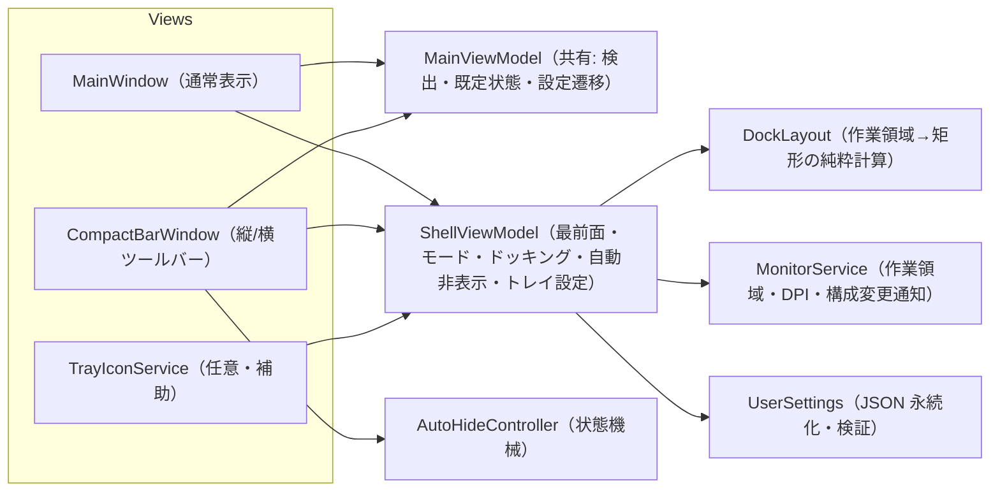
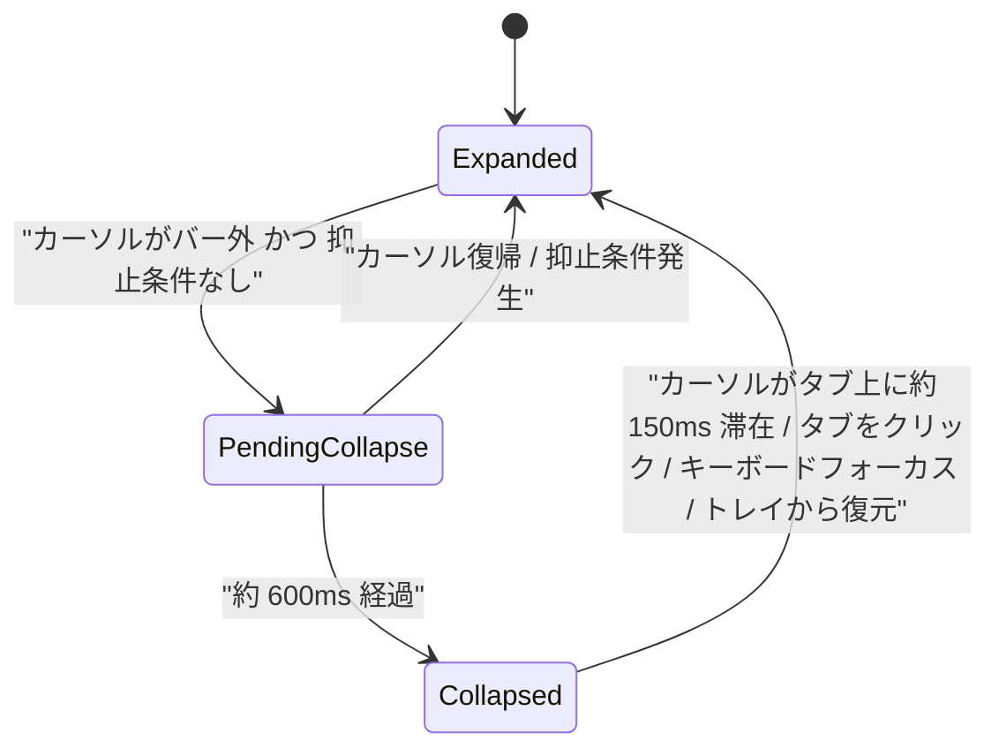

# バックログ / 次期バージョン設計（v0.2 デスクトップ操作性の強化）

> 対象: BrowserFlip v0.2（MVP v0.1 の後続）。目的は日常利用時の操作性と完成度の向上であり、機能範囲の無制限な拡大は行わない。
> 既存のブラウザー検出・Windows 設定遷移・既定ブラウザー判定（v0.1）は変更せず維持する。
> 状態: **計画済み（実装中）**。完了した項目は [CHANGELOG.md](../CHANGELOG.md) に記録する。

## 1. 要件一覧

| ID | 要件 | 概要 |
|---|---|---|
| V2-01 | 専用アプリアイコン | 地球（ブラウザー）＋切替矢印のオリジナル図案。SVG マスター、PNG 16/24/32/48/64/128/256/512、多解像度 ICO。EXE・ウィンドウ・タスクバー・通知領域に適用（インストーラーは将来）。既存ブラウザーのロゴと混同しない |
| V2-02 | 最前面表示 | ピンボタンで `Topmost` を ON/OFF。通常・コンパクト両モード対応、設定を保存。全画面アプリ実行中は最前面を一時解除しシステム UI を妨げない |
| V2-03 | コンパクトモード | ワンクリックで小型ツールバーへ切替。横型（高さ約 48 DIP）／縦型（幅約 56 DIP）。既定ブラウザーを強調、ホバーで名前の Tooltip、設定ボタン・通常画面復帰ボタン。多数のブラウザーはスクロール |
| V2-04 | 画面端ドッキング | 左・右・上・下。ドラッグで画面端に近づくとスナップ。モニターごとの作業領域・DPI・タスクバー位置を考慮 |
| V2-05 | 自動表示・非表示 | ドッキング中のみ有効化可能。一定時間操作がなければ収納し 8 DIP の操作用タブを残す。タブへの接近で展開、離脱後約 600ms で収納 |
| V2-06 | システムトレイ（補助） | 左クリックで復元、右クリックメニュー（最前面・コンパクト・ドッキング・自動非表示・設定・終了）。「閉じるとトレイへ格納」は既定 OFF。トレイ無効でも通常アプリとして完全に利用可能 |
| V2-07 | 設定の永続化 | 表示モード、最前面、ドッキング有効/位置、対象モニター、自動非表示、言語、テーマ、ウィンドウサイズ・位置、トレイ設定。v0.1 の設定ファイルと互換 |
| V2-08 | 複数モニター・DPI | Per-Monitor V2。接続/切断、解像度・拡大率変更、スリープ復帰、Explorer 再起動、タスクバー位置変更後に再配置。画面外へ消えない |

## 2. 設計方針

- **既存ロジックの再利用**: Core と `MainViewModel` を共有し、コンパクトバーは同じ ViewModel の別ビューとする。
- **独立した状態管理**: ドッキング／自動非表示は `AutoHideController`（純粋な状態機械、時刻と入力を外部から与える）として実装し、ウィンドウ操作と分離する。配置計算は `DockLayout`（純粋関数）とする。いずれも単体テスト可能。
- **イベントループ防止**: ウィンドウ移動はコード側の移動とユーザーのドラッグを区別するガードを持ち、`LocationChanged` からの再配置が再帰しないようにする。
- **常駐負荷の最小化**: グローバルフックは使わない。カーソル位置の確認はドッキング＋自動非表示が有効な間のみ約 100ms 間隔で行い、無効時はタイマーを停止する。常駐サービス、通知、広告は追加しない。
- **AppBar 登録はしない**: `SHAppBarMessage` による作業領域の予約は行わず、作業領域内へのオーバーレイ表示とする（タスクバーや他ウィンドウのレイアウトに干渉しない）。
- **アニメーション**: Windows の「アニメーション効果」設定（`SystemParameters.ClientAreaAnimation`）が OFF の場合は即時に表示／収納する。
- **安全性は v0.1 と同一**: レジストリ書き込みなし、管理者権限不要、ネットワーク通信なし。

## 3. 構成

### 自動表示・非表示の状態遷移

抑止条件（収納しない）: マウスボタン押下中、ドラッグ中、メニュー・設定表示中、ウィンドウにキーボードフォーカスがある間、設定画面での変更待ち中。

## 4. 受入条件

1. 置頂を有効にすると前面に表示され、再起動後も維持される。全画面アプリ実行中は前面に割り込まない。
2. コンパクトバーのブラウザーをクリックすると v0.1 と同じ設定画面遷移・状態更新が行われる（回帰なし）。
3. 左右ドッキングでは縦型、上下では横型となり、各モニターの作業領域（タスクバーを除く）内に収まる。ドラッグで端に近づけるとスナップする。
4. 自動非表示では収納時に 8 DIP のタブのみ表示され、タブへの接近で展開、離脱後約 600ms で収納される。抑止条件中は収納されない。
5. モニターの接続・切断、解像度／拡大率変更、スリープ復帰、タスクバー位置変更後も画面内に再配置される。保存位置が画面外なら補正される。
6. トレイ有効時は左クリックで復元、右クリックメニューから全操作が可能。Explorer 再起動後もアイコンが再表示される。トレイ無効時はアイコンを表示せず、通常アプリとして全機能が使える。
7. 設定は `%LOCALAPPDATA%\BrowserFlip\settings.json` に保存され、v0.1 の設定ファイルを読み込める。不正な値は既定値に戻る。
8. 100% / 125% / 150% / 200% の拡大率、拡大率の異なる 2 モニター環境で表示が崩れない。
9. 終了時にトレイアイコンと関連リソースが解放される。

## 5. 対象外（v0.2 では実施しない）

グローバルショートカット、起動時自動実行、インストーラー、更新通知、パッケージ版ブラウザー（MSIX）の検出 — 引き続き将来検討。
