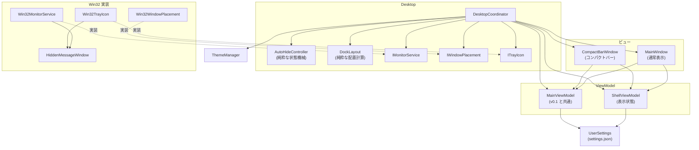
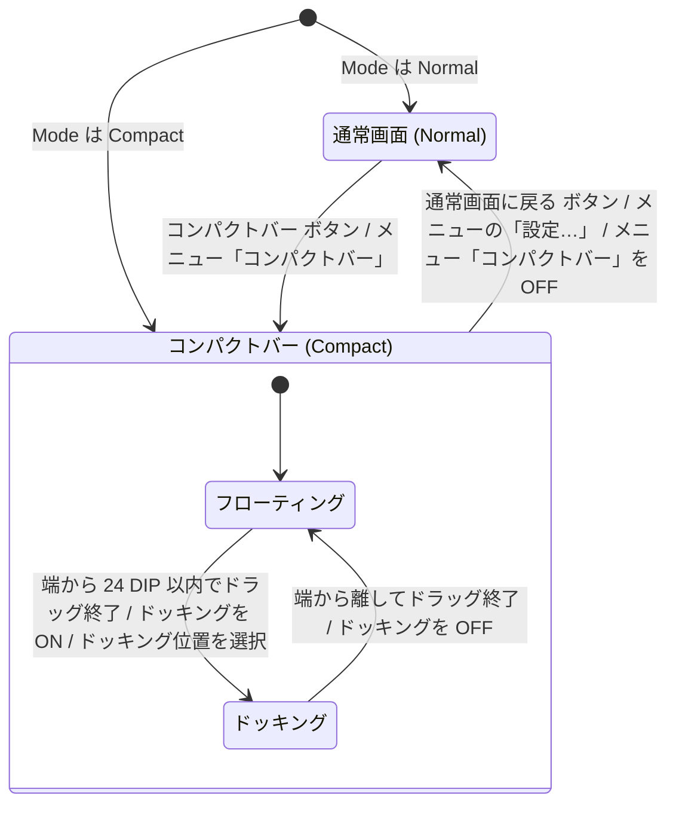
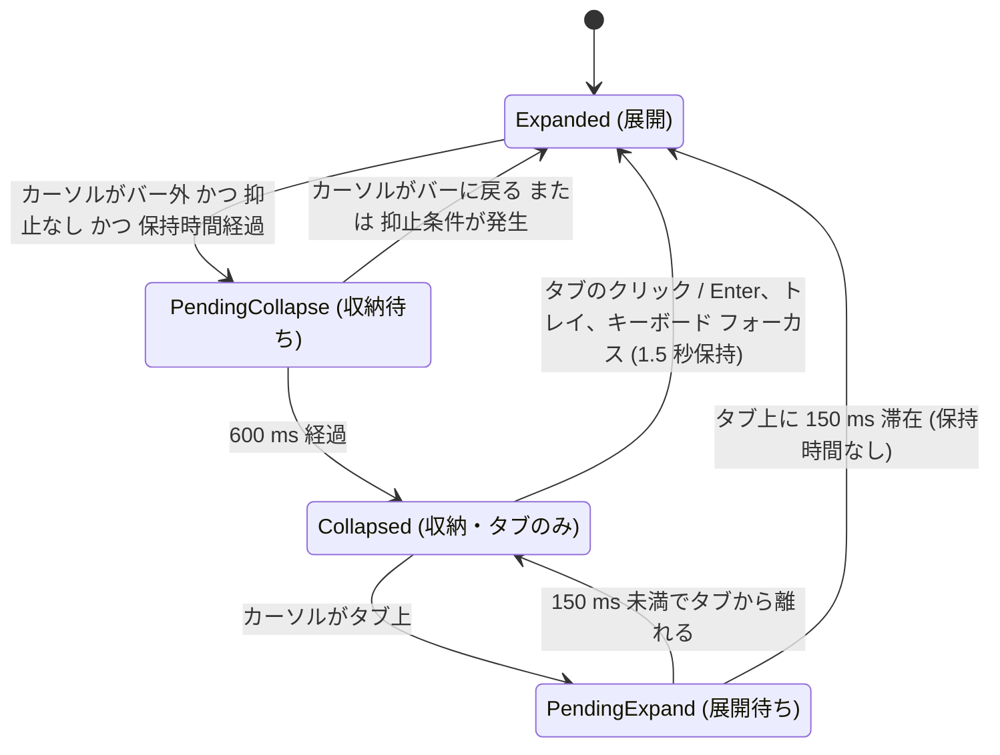

# v0.2 デスクトップ機能 設計書

BrowserFlip v0.2 で追加したデスクトップ操作機能(最前面表示、コンパクトバー、画面端ドッキング、自動的に隠す、通知領域アイコン、複数モニター / DPI 対応、設定の永続化)の設計をまとめます。

- 状態: **実装済み(v0.2、未リリース)**
- 要件と受け入れ条件: [backlog.md](backlog.md) / [requirements.md](requirements.md) の「v0.2」節
- 全体構成(Core・検出・設定遷移): [architecture.md](architecture.md)
- テスト: [testing.md](testing.md) / 操作説明: [user-guide.ja.md](user-guide.ja.md)

## 1. 目的と範囲

### 目的

v0.1 の「ワンクリックで Windows の設定へ」という体験を、常に手元に置いておける小さな UI で使えるようにすること。日常的に使うときの操作性と完成度を上げ、機能範囲は広げすぎない。

### 範囲

| 対象 | 内容 |
| --- | --- |
| 対象(v0.2) | 専用アイコン(V2-01)、最前面表示(V2-02)、コンパクトバー(V2-03)、画面端ドッキング(V2-04)、自動的に隠す(V2-05)、通知領域アイコン(V2-06)、設定の永続化(V2-07)、複数モニター・DPI(V2-08) |
| 変更しないもの | ブラウザー検出、既定ブラウザーの取得、Windows 設定への遷移、変更の判定(v0.1 の Core と `MainViewModel`) |
| 対象外 | グローバル ショートカット、自動起動、インストーラー、更新通知、AppBar(作業領域の予約) |

安全性の方針は v0.1 と同じです(レジストリ書き込みなし、管理者権限不要、ネットワーク通信なし、グローバル フックなし)。

## 2. 構成

### コンポーネント

| コンポーネント | 場所 | 役割 |
| --- | --- | --- |
| `DesktopCoordinator` | `src/BrowserFlip.App/Desktop/DesktopCoordinator.cs` | メイン ウィンドウ・コンパクトバー・通知領域アイコンを所有し、`ShellViewModel` の状態をウィンドウへ適用する唯一の場所。モード切替、最前面、配置、自動的に隠す、ディスプレイ変更からの復旧、メニュー構築を担当 |
| `ShellViewModel` | `src/BrowserFlip.App/ViewModels/ShellViewModel.cs` | ウィンドウ レベルの状態(最前面、モード、ドッキング、自動的に隠す、テーマ、バーのサイズ・向き、トレイ)。変更のたびに `UserSettings.Save()` を呼ぶ。ウィンドウには直接触れない |
| `MainViewModel` | `src/BrowserFlip.App/ViewModels/MainViewModel.cs` | v0.1 と共通。検出・既定状態・設定遷移。メイン ウィンドウとコンパクトバーで共有 |
| `AutoHideController` | `src/BrowserFlip.App/Desktop/AutoHideController.cs` | 自動的に隠す機能の純粋な状態機械。タイマーもウィンドウも持たず、時刻と観測値を入力として受け取る |
| `DockLayout` | `src/BrowserFlip.App/Desktop/DockLayout.cs` | 配置計算の純粋関数(ドッキング矩形、タブ矩形、スナップ判定、画面内への補正)。物理ピクセルで計算 |
| `IMonitorService` | `Desktop/Abstractions.cs` | モニター一覧・作業領域・DPI、カーソル位置、全画面状態、マウス ボタン状態、ディスプレイ変更通知 |
| `IWindowPlacement` | `Desktop/Abstractions.cs` | 物理ピクセルでのウィンドウ矩形の取得・設定・移動 |
| `ITrayIcon` | `Desktop/Abstractions.cs` | 通知領域アイコン(表示、ツールチップ、クリック / メニュー要求、DPI 変更時のアイコン再読込) |
| `Win32MonitorService` | `Desktop/Win32/Win32MonitorService.cs` | `EnumDisplayMonitors` / `GetMonitorInfoW` / `GetDpiForMonitor` / `SHQueryUserNotificationState` / `GetAsyncKeyState`。変更通知は 250 ms のデバウンス付き |
| `Win32WindowPlacement` | `Desktop/Win32/Win32WindowPlacement.cs` | `GetWindowRect` / `SetWindowPos`(Z オーダー変更なし・非アクティブ化なし) |
| `Win32TrayIcon` | `Desktop/Win32/Win32TrayIcon.cs` | `Shell_NotifyIconW`(`NOTIFYICON_VERSION_4`、hWnd + uID で識別、GUID なし) |
| `HiddenMessageWindow` | `Desktop/Win32/HiddenMessageWindow.cs` | ブロードキャスト受信用の非表示トップレベル ウィンドウ(`HWND_MESSAGE` は `WM_DISPLAYCHANGE` や `TaskbarCreated` を受け取れないため使わない) |
| `UserSettings` | `src/BrowserFlip.App/Services/UserSettings.cs` | 設定ファイル(JSON)の読み書き。フィールド単位のフォールバック、アトミック保存 |
| `ThemeManager` | `src/BrowserFlip.App/Services/ThemeManager.cs` | システム / ライト / ダークの適用(ハイ コントラスト時はハイ コントラスト テーマを優先) |
| `MainWindow` / `CompactBarWindow` | `src/BrowserFlip.App/` | ビュー。`CompactBarWindow` は描画とユーザー操作の通知(ドラッグ開始 / 終了、タブ操作、メニュー要求)のみを行う |

コンポジション ルートは `App.OnStartup` です。`UserSettings.Load` → 言語・テーマ適用 → `MainViewModel` / `ShellViewModel` / `Win32MonitorService` 生成 → `DesktopCoordinator` 生成 → `Start()` の順に初期化します。通知領域アイコンはファクトリ(`Func<ITrayIcon>`)で渡し、トレイが有効なときだけ生成します。

### 責務分離の原則

- **ViewModel はウィンドウに触れない**: `ShellViewModel` は状態と保存のみ。ウィンドウへの適用は `DesktopCoordinator` が `PropertyChanged` を監視して行う。
- **状態機械と配置計算を分離**: `AutoHideController` は「展開 / 収納」だけを決め、`DockLayout` は「どこに置くか」だけを決める。両者は互いを知らない。
- **OS 依存はインターフェイス越し**: `IMonitorService` / `IWindowPlacement` / `ITrayIcon` を介すことで、純粋ロジックは OS なしで単体テストできる。

## 3. 状態管理

### 3.1 表示モードとドッキング

| 状態 | 保存先 | 説明 |
| --- | --- | --- |
| 表示モード | `Mode`(`Normal` / `Compact`) | 通常画面とコンパクトバーは同時に表示しない |
| ドッキング | `DockEnabled`, `DockEdge`, `DockPosition`, `DockMonitor` | コンパクトバーを画面端に固定するか、自由配置(フローティング)にするか |
| 向き | 計算値 | 左右ドッキング = 縦、上下ドッキング = 横、フローティング = `FloatingOrientation` |
| 自動的に隠す | `AutoHide` | 設定値。実際に動作するのは `AutoHide && DockEnabled` かつコンパクト モードのときだけ(`IsAutoHideActive`) |

補足:

- 起動時は保存された `Mode` のまま復元します(上図の `[*]` からの 2 本の遷移)。コンパクト側の初期状態は `DockEnabled` に従います(図は簡略化のためフローティングを初期状態としています)。
- コンパクト モード中はメイン ウィンドウを非表示にし、コンパクトバーのみを表示します。
- メニューの「BrowserFlip を表示」と通知領域アイコンの左クリックは、通常モードではメイン ウィンドウを表示・アクティブ化し、コンパクト モードではバーを展開してアクティブ化します(モードは変えません)。

### 3.2 自動的に隠す(`AutoHideController`)

| 定数 | 値 | 意味 |
| --- | --- | --- |
| `InitialIdle` | 1.5 秒 | 有効化直後・強制展開(タブのクリック、トレイ、ドラッグ、キーボード フォーカス)後は、この間は収納しない |
| `CollapseDelay` | 600 ms | カーソルがバーから離れてから収納までの待ち時間 |
| `ExpandDwell` | 150 ms | タブ上にカーソルが留まってから展開するまでの時間(通過しただけでは開かない) |
| カーソル判定のヒステリシス | 8 DIP | バーの外周 8 DIP までは「バーの上」とみなす |
| タブ近接判定 | 6 DIP | タブの外周 6 DIP まで近づけば「タブの上」とみなす |
| タブ サイズ | 8 × 56 DIP | 収納時に画面端に残す操作用のつまみ(端に密着、展開時のバーの中央に配置) |

**抑止条件**(収納を始めない / 収納待ちを取り消す。収納済みのバーを展開する条件ではない):

- バーの上でマウス ボタンが押されている(`GetAsyncKeyState`)
- バーをドラッグ中(`DragMove` 実行中)
- コンテキスト メニューが開いている
- バーにキーボード フォーカスがある

**抑止しないもの**: Windows の設定で既定の変更を待っている間(`MainViewModel.IsWaitingForChange`)は抑止しません。ブラウザーをクリックして設定画面が開いたら、バーは通常どおり収納され、設定画面の操作を妨げません。変更の検出は v0.1 と同じポーリング(約 1.5 秒間隔)で行われ、バーが収納されていても続きます。

無効化(`AutoHide` を OFF、またはドッキングを OFF)すると、ただちに展開状態に戻ります。

### 3.3 最前面表示

- 設定値 `Topmost` は通常画面とコンパクトバーの両方に適用します。
- 実際に適用する値は `EffectiveTopmost = Topmost && !IsFullScreenAppActive` です。
- `Topmost` が ON の間だけ 1 秒ごとに `SHQueryUserNotificationState` を確認し、`QUNS_BUSY`(全画面アプリ)/ `QUNS_RUNNING_D3D_FULL_SCREEN` / `QUNS_PRESENTATION_MODE` のいずれかなら最前面を一時的に解除します。状態が戻れば最前面に戻ります。設定値 `Topmost` 自体は変更しません。

## 4. 配置計算

### 4.1 座標系

| 量 | 単位 | 理由 |
| --- | --- | --- |
| モニター矩形・作業領域 | 物理ピクセル(仮想スクリーン座標) | Win32 API がそのまま返す値。モニターごとに DPI が異なっても単一の座標系で扱える |
| コンパクトバーの位置・大きさ(適用時) | 物理ピクセル | `SetWindowPos` で直接適用する。WPF の DIP 座標はモニター間で曖昧になるため使わない |
| バーの太さ・余白・タブなどの定数 | DIP | 見た目の大きさを拡大率に依存させないため。適用直前に `Math.Round(dip × scale)` でピクセルに変換 |
| メイン ウィンドウの位置 | 物理ピクセル(`MainBounds` の Left / Top) | 保存したモニター上の位置に正確に戻すため |
| メイン ウィンドウの大きさ | DIP(`MainBounds` の幅・高さ ÷ `MainScale`) | 拡大率の異なるモニターでも見た目の大きさを一定にするため |

### 4.2 コンパクトバーの寸法

| 向き | 小 | 中 |
| --- | --- | --- |
| 横(高さ) | 44 DIP | 52 DIP |
| 縦(幅) | 48 DIP | 56 DIP |

ボタンは小 36 DIP / 中 44 DIP、アイコンは小 24 DIP / 中 28 DIP。バーの長さは内容(ブラウザー数)から測定し、作業領域の長さ − 2 × 余白を上限とします。収まらないブラウザーはバー内でスクロールします(横向きではマウス ホイールを横スクロールに変換)。

### 4.3 ドッキング

- 対象モニター: `DockMonitor`(`\\.\DISPLAY2` などのデバイス名)。見つからなければプライマリ モニター。
- 作業領域(タスクバーを除いた領域)の内側に、端から **4 DIP** の余白を空けて配置します。
- `DockPosition`(0〜1)は辺に沿ったバー中心の位置です。範囲外や非数値は補正されます。
- 収納時のタブは端に密着させ、展開時のバーの中央に合わせ、作業領域からはみ出さないように補正します。
- **AppBar 登録はしません**(`SHAppBarMessage` を使わない)。バーは作業領域上のオーバーレイであり、作業領域を変更せず、他のウィンドウの最大化サイズやタスクバーに影響しません。

### 4.4 ドラッグとスナップ

- バーの何もない部分(ボタン以外)を左ドラッグすると `DragMove` で移動します。
- ドラッグ終了時、バーの中心があるモニターの作業領域の各辺との距離を測り、最も近い辺が **24 DIP 以内** ならその辺にドッキングします(`DockMonitor` と `DockPosition` も更新)。
- どの辺からも離れていればフローティングになり、位置を `CompactBounds`(物理ピクセル)に保存します。
- ドラッグ開始時とドラッグ終了後は自動的に隠す機能を強制展開し(1.5 秒保持)、ドラッグ直後に収納されないようにします。

### 4.5 フローティング位置と画面外からの復旧

- 初期位置は対象モニターの作業領域の右上(端から 24 DIP)。
- 保存位置は `DockLayout.EnsureVisible` で検査し、どの作業領域とも十分に重ならない場合(モニター切断など)は最も重なりの大きいモニター、なければプライマリ モニターの中央に移します。さらに中心のあるモニターの作業領域に完全に収まるよう `ClampInto` します。
- メイン ウィンドウも起動時・表示時・ディスプレイ変更時に `EnsureVisible`(最低 48 px の可視部分)で検査し、タイトル バーが作業領域の上にはみ出していれば下げます。大きさは着地したモニターの作業領域を超えないように制限します。

### 4.6 DPI をまたぐ移動

拡大率の異なるモニターへバーを移す場合、いきなり最終矩形を設定すると、Windows / WPF が `WM_DPICHANGED` で大きさを再計算し、結果がずれることがあります。そこで次の手順を取ります。

1. WPF の `Width` / `Height`(DIP)を、移動先の拡大率で換算した値に先に更新する(古い DIP サイズが再適用されるのを防ぐ)。
2. 移動元と移動先でモニターも拡大率も異なる場合は、まず **位置だけを移動**(`SWP_NOSIZE`)して DPI 変更を起こさせる。同じ場合は矩形をそのまま設定する。
3. WPF が DPI 変更を処理した後(Dispatcher の Background 優先度)、実際の矩形を確認し、目標と異なれば正確な矩形を設定し直す。この確認は **最大 3 回** で打ち切り、無限ループにならない。

## 5. イベントループの防止

| 仕組み | 内容 |
| --- | --- |
| 再入ガード | コードによる移動はすべて `_applying` フラグの内側で行い、その間に発生した配置処理は無視する |
| ユーザー操作の区別 | 位置の保存とスナップ判定は `LocationChanged` ではなく、ドラッグ終了(`DragMove` からの復帰)時だけ行う。コードによる移動では保存しない |
| 一方向のデータの流れ | `ShellViewModel`(状態)→ `DesktopCoordinator`(適用)。適用結果を状態に書き戻すのはドラッグ終了時のみ |
| 状態機械の分離 | `AutoHideController` は配置を知らず、配置計算は状態機械を呼ばない。収納状態が変わったときだけ `Layout()` を呼ぶ |
| 有限回の確認 | DPI またぎの確認は最大 3 回 |
| 変更通知のデバウンス | ディスプレイ関連の通知は 250 ms のデバウンスで 1 回にまとめる |
| 遅延レイアウト | DPI 変更・テーマ変更・ブラウザー一覧の変更による再配置は Dispatcher の Background 優先度で 1 回実行する |

## 6. 常駐負荷

- グローバル フック(`SetWindowsHookEx`)は使いません。
- カーソル位置のポーリング(100 ms 間隔、`DispatcherPriority.Input`)は **コンパクト モード かつ ドッキング中 かつ 自動的に隠す が ON** のときだけ動作し、それ以外では停止します。
- 全画面状態の確認(1 秒間隔)は **最前面表示が ON** のときだけ動作します。
- ディスプレイ変更は OS からの通知(イベント駆動)で受け取り、ポーリングしません。
- v0.1 の既定変更の監視(約 1.5 秒間隔、最大 3 分)は Windows の設定を開いた後の待機中だけ動作します。
- 終了時はタイマーを停止し、通知領域アイコン・HICON・非表示ウィンドウ・`SystemEvents` の購読を解放します。

## 7. 通知領域アイコン(トレイ)

| 項目 | 仕様 |
| --- | --- |
| API | `Shell_NotifyIconW`、`NIM_SETVERSION` で `NOTIFYICON_VERSION_4`。hWnd + uID で識別し、GUID は使わない(GUID は実行ファイルのパスに結び付くため、ポータブルな exe を移動すると壊れる) |
| 既定 | **有効**(`TrayEnabled = true`)。表示オプションの「通知領域にアイコンを表示」で OFF にできる |
| 左クリック / Enter | `NIN_SELECT` / `NIN_KEYSELECT`。通常モードではメイン ウィンドウを表示、コンパクト モードではバーを展開。Enter の二重通知は 150 ms 以内をまとめる |
| 右クリック / メニュー キー | `WM_CONTEXTMENU`。メニュー: **BrowserFlip を表示** / 常に手前に表示 / コンパクトバー / 画面端にドッキング / ドッキング位置(左・右・上・下)/ 自動的に隠す(ドッキング中のみ有効)/ 設定… / 終了 |
| メニューの閉じ方 | 表示前に `SetForegroundWindow`、閉じた後に `WM_NULL` を送る(外側クリックや Esc で確実に閉じるため) |
| Explorer の再起動 | `TaskbarCreated` メッセージを受けてアイコンを再読込・再登録。昇格時にも届くよう `ChangeWindowMessageFilterEx` で許可 |
| ツールチップ | 「BrowserFlip — 既定: {ブラウザー名}」(127 文字で切り詰め、サロゲート ペアは分割しない) |
| アイコン | 実行ファイルの最初のアイコンを、現在の DPI の小アイコン サイズで取り出す。ディスプレイ変更時に再読込 |
| 閉じる動作 | 「ウィンドウを閉じても通知領域で動作を継続」(`CloseToTray`)は **既定 OFF**。トレイが有効なときだけ選択できる。OFF のときメイン ウィンドウを閉じるとアプリは終了する(v0.1 と同じ) |
| トレイ無効時 | アイコンは表示しない。全機能はメイン ウィンドウとコンパクトバー(右クリック メニュー)から使える。トレイを OFF にした時点でメイン ウィンドウが隠れていれば再表示する |

コンパクトバー上の右クリック(またはアプリケーション キー / Shift+F10)でも同じメニューを表示します。

通知領域のメニューは **ネイティブのポップアップ メニュー**(`TrackPopupMenuEx`、同期実行、`SetForegroundWindow` → 表示 → `WM_NULL` の定石)で表示します。WPF の `ContextMenu` を非表示の所有ウィンドウから開く方式は、Windows 11 の実機(特にオーバーフロー領域のアイコン)でメニューが表示されないことを確認したため採用していません。メニュー定義は 1 つのモデル(`TrayMenuItem`)を共有し、コンパクトバーではそれを WPF メニューに変換して表示します。

## 8. 設定ファイル仕様

- 既定の場所: `%LOCALAPPDATA%\BrowserFlip\settings.json`
- コマンドライン `--settings <パス>` で別のファイルを使用できます(テストや将来のポータブル版向け)。
- 保存: 変更のたびに同じフォルダーの `settings.json.tmp` へ書き込んでから置き換える(アトミック保存)。書き込みに失敗してもアプリは動作を続ける。
- 読み込み: フィールドごとに独立して検証し、欠落・型違い・範囲外の値はそのフィールドだけ既定値に戻す。ファイルが壊れていれば全体を既定値で起動する。
- v0.1 互換: v0.1 の設定ファイル(`Language` のみ)はそのまま読み込める。

| フィールド | 型 / 値 | 既定値 | 説明・検証 |
| --- | --- | --- | --- |
| `Language` | 文字列(`""` / `en` / `ja` / `zh-CN`) | `""` | 空は Windows の言語に従う。16 文字を超えると既定値 |
| `Theme` | `System` / `Light` / `Dark` | `System` | ハイ コントラスト時はハイ コントラスト テーマを優先 |
| `Mode` | `Normal` / `Compact` | `Normal` | 起動時の表示モード |
| `Topmost` | 真偽値 | `false` | 常に手前に表示 |
| `DockEnabled` | 真偽値 | `false` | コンパクトバーのドッキング |
| `DockEdge` | `Left` / `Right` / `Top` / `Bottom` | `Right` | ドッキングする辺 |
| `DockPosition` | 数値 0〜1 | `0.5` | 辺に沿ったバー中心の位置。範囲外は切り詰め、非数値は 0.5 |
| `DockMonitor` | 文字列(例 `\\.\DISPLAY2`) | `""` | ドッキング先モニターのデバイス名。空または見つからなければプライマリ。64 文字を超えると既定値 |
| `AutoHide` | 真偽値 | `false` | 自動的に隠す(ドッキング中のみ動作) |
| `BarSize` | `Small` / `Medium` | `Small` | バーのサイズ |
| `FloatingOrientation` | `Horizontal` / `Vertical` | `Horizontal` | ドッキングしていないときの向き |
| `TrayEnabled` | 真偽値 | `true` | 通知領域にアイコンを表示 |
| `CloseToTray` | 真偽値 | `false` | ウィンドウを閉じても通知領域で動作を継続(`TrayEnabled` が `true` のときのみ有効) |
| `MainBounds` | `{Left, Top, Width, Height}`(整数、物理ピクセル)または `null` | `null` | メイン ウィンドウの位置と大きさ。幅・高さは正、各値の絶対値は 100000 未満 |
| `MainScale` | 数値 0.5〜5 | `1.0` | `MainBounds` を保存したときのモニターの拡大率 |
| `CompactBounds` | `{Left, Top, Width, Height}` または `null` | `null` | フローティング時のバーの位置(物理ピクセル) |

列挙値は名前(大文字小文字を区別しない)のみ受け付け、数値文字列や未定義の値は既定値に戻します。メイン ウィンドウの位置は、最小化・最大化されておらず表示中のときだけ、終了時と通知領域へ隠すときに保存します。

## 9. ディスプレイ構成の変更

`Win32MonitorService` は次の通知を受けて(250 ms デバウンス後)`DisplayChanged` を発行し、`DesktopCoordinator` がバーの再配置・メイン ウィンドウの画面内補正・トレイ アイコンの再読込を行います。

- `WM_DISPLAYCHANGE`(解像度・モニター構成)
- `WM_SETTINGCHANGE` + `SPI_SETWORKAREA`(作業領域・タスクバーの位置や大きさ)
- `SystemEvents.DisplaySettingsChanged`
- `SystemEvents.PowerModeChanged`(`Resume`: スリープ復帰)
- `SystemEvents.UserPreferenceChanged`(`Desktop` / `Window`)

バー自身の `DpiChanged` でも再配置します。Per-Monitor V2 はアプリケーション マニフェストで宣言しています。

## 10. アイコン(V2-01)

`assets/icon/` のオリジナル図案(地球 + 2 本の循環矢印、青い角丸タイル)。既存ブラウザーのロゴに似せないよう意図的にデザインしています。SVG マスターから PNG(16〜512 px)と多解像度 ICO(16 / 20 / 24 / 32 / 40 / 48 / 64 / 256 px)を生成し、EXE・ウィンドウ・タスクバーに適用、通知領域アイコンは実行時に EXE から取り出します。コードと同じ MIT ライセンスです。詳細は [assets/icon/README.md](../assets/icon/README.md) を参照してください。

## 10.1 通常画面のレイアウト(UI 改善)

- `SizeToContent="Height"`、幅 520 DIP(最小 460)。高さは内容(ブラウザー数・メッセージ・表示オプション)で決まり、`MaxHeight` を表示中モニターの作業領域に合わせて更新(`DpiChanged` / `LocationChanged` / `Loaded`)。超過分はルートの `ScrollViewer` でスクロール。
- 位置と幅は従来どおり保存・復元し、高さは保存しない(内容から決まるため)。ユーザーが手動でサイズを変えた場合は WPF の仕様どおり `SizeToContent` が解除され、その大きさを保ちます。
- 標準コントロール(ComboBox / CheckBox / Expander / ScrollViewer)には .NET 10 WPF 組み込みの Fluent スタイルを **通常画面のみ** に適用(`Window.ThemeMode`)。ハイ コントラスト時は `ThemeMode.None`(システム配色)。コンパクトバーは透過レイヤード ウィンドウのため対象外。`ThemeMode` は .NET 10 時点で試験的 API(WPF0001)です。
- 余白 16 / 8 DIP、角丸 8 DIP(カード・帯)/ 4 DIP(ボタン)、文字 16(名称)/ 13〜13.5(本文)/ 11.5 DIP(補足)に統一。

## 11. 既知の制限

- **単一ファイル圧縮**: 配布サイズ削減のため単一ファイル内のアセンブリを圧縮しています(約 131 MB → 62 MB)。起動時に展開されるため、非圧縮版より起動がわずかに遅く、作業セットがやや増えます。
- **キーボードで開いた通知領域メニュー**: マウス カーソル位置に表示されます(アイコン位置ではありません)。

- **AppBar ではない**: ドッキングしたバーは作業領域を予約しないため、最大化したウィンドウの上に重なります(最前面表示が OFF なら後ろに隠れることがあります)。
- **コンパクトバーには案内・結果メッセージを表示しない**: 「Windows の設定での変更を待っています…」や変更結果(成功・キャンセル)のメッセージは通常画面にのみ表示されます。コンパクトバーでは既定ブラウザーの強調表示が更新されることで結果が分かります。再確認はバーのアクティブ化(設定画面から戻ってバーをクリック)でも行われます。**エラー**(ブラウザーが見つからない・ポリシーで禁止・設定を開けない)が発生した場合は、内容を確認できるよう自動的に通常画面へ戻ります。
- **Alt+F4 でバーを閉じた場合**: バーは破棄されず、通常画面に戻ります(アプリを終了するにはメニューまたは通知領域の「終了」を使用します)。
- **全画面の判定は `SHQueryUserNotificationState` に依存**: アプリによっては全画面と判定されない(ボーダーレス ウィンドウ化したゲームなど)場合があり、その間は最前面のままになります。判定は 1 秒間隔のため、切り替わりに最大約 1 秒の遅れがあります。
- **モニターの識別はデバイス名**: `\\.\DISPLAYn` は接続順やドライバーの更新で変わることがあり、その場合はプライマリ モニターにドッキングし直します。
- **セキュア デスクトップ / ロック中**: カーソル位置を取得できない間は自動的に隠す機能の状態を変えません。
- **アニメーション**: 展開時の短いフェードのみ。Windows の「アニメーション効果」が OFF の場合は即時表示です。
- **グローバル ショートカットなし**: 収納されたバーをキーボードだけで呼び出す専用のショートカットはありません(通知領域アイコンは Win+B でフォーカスし Enter で展開できます)。
